<div align="center">

# easy-ha-proxy

**A secure HTTPS gateway for your self-hosted services, installed with one command.**

HAProxy, Let's Encrypt, Authelia single sign-on and adaptive attack protection,
managed from a clean web panel. Runs on a VPS, a home server or an ARM board.

[](https://github.com/CLLlAgOB/easy-ha-proxy/actions/workflows/ci.yml)
[](LICENSE)


[English](README.md) | [Русский](README.ru.md)

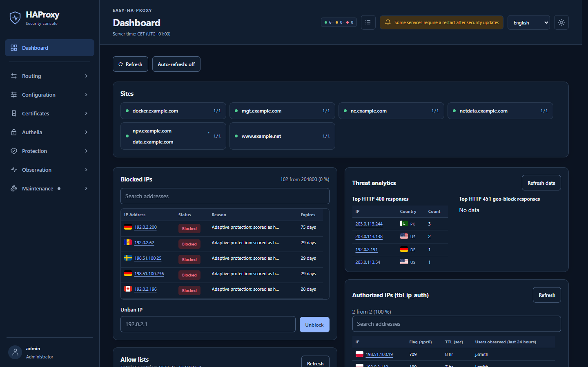

</div>

## Why easy-ha-proxy

**One command to install.** An interactive assistant (English or Russian) sets up
everything on the server itself, or from your laptop over SSH. It checks what
is already there and offers only the steps that make sense. No public DNS yet?
Test mode uses a local CA, and you can promote it to production later without
reinstalling.

**Secure by default.** Every admin page sits behind Authelia with two-factor
login (TOTP, WebAuthn/passkeys). Adaptive protection scores scanners and
brute-forcers and bans them in HAProxy and the firewall. Bans grow longer for
repeat offenders: 1 hour, 7 days, 30 days, 90 days. On top of that you get
per-site GeoIP filtering, IP allow-lists, zero trust and client certificates
(mTLS). The panel runs unprivileged and reaches the host only through narrow
helper APIs. GeoIP lookups and country flags work offline, so visitor
addresses never go to third parties.

**Ports that open only after sign-in.** Mark a TCP proxy, a UDP forward
or a site as zero trust, and it answers only addresses that have signed in.
RDP, SSH, WireGuard, a database or a game server stay closed to the internet.
A user opens your sign-in page, passes Authelia with two-factor login, and
their current IP address gets access for a set time. Nothing to install on
the client, no VPN to set up. The same page can carry instructions and files
for your users.

**Fast and light.** HAProxy does the work at the edge. The whole stack (HAProxy,
Authelia, Redis, the panel and its helper daemons) uses about **300 MB of RAM**,
measured on a 4-core ARM64 board with 2 GB. Configuration changes go out as a
seamless HAProxy reload, so open connections are not dropped. Updates can
run only the steps that the changed files actually need.

**You see everything.** A dashboard, monitoring graphs from an hour to a year,
live activity, a searchable request log with CSV export, email alerts and a
Prometheus endpoint. The interface comes in English and Russian, in light and
dark themes.

## Quick start

You need a server with Debian 12+ or Ubuntu 22.04+ (amd64 or arm64), root or
`sudo`, open ports 80 and 443, and DNS records for the admin and login domains.
Without DNS records, use test mode.

```bash
curl -fsSLo /tmp/easy-ha-proxy-install.sh https://raw.githubusercontent.com/CLLlAgOB/easy-ha-proxy/main/install.sh
```

```bash
bash /tmp/easy-ha-proxy-install.sh
```

The script is saved to a file first, so you can read it before running it. The
assistant asks for your domains, an email for Let's Encrypt and the first
administrator account. When it finishes, open your admin domain, sign in
through Authelia and you are in the panel.

Other ways to start:

```bash
bash /tmp/easy-ha-proxy-install.sh remote admin@server.example.com
```

```bash
bash /tmp/easy-ha-proxy-install.sh local --test-mode
```

The first installs on a remote server over SSH from your workstation, which
needs only `bash`, `curl`, `ssh` and `scp`. The second installs without public
DNS: it uses `.test` domains and a local CA.

Step by step: [Quick Start](docs/quickstart.md) · every option:
[installer guide](docs/installer.md).

## Screenshots

<table>
  <tr>
    <td width="50%">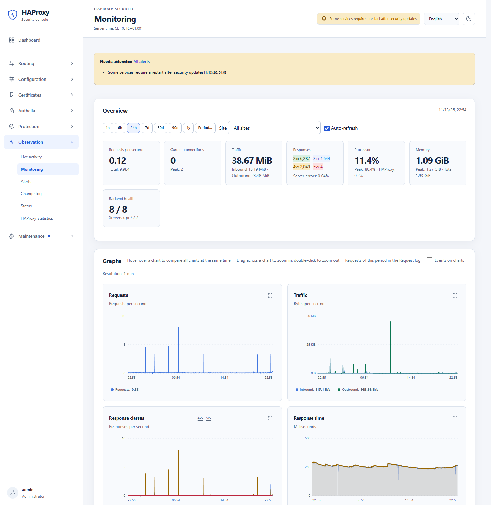<br><b>Monitoring.</b> Requests, traffic, response classes and response time, from 1 hour to 1 year.</td>
    <td width="50%">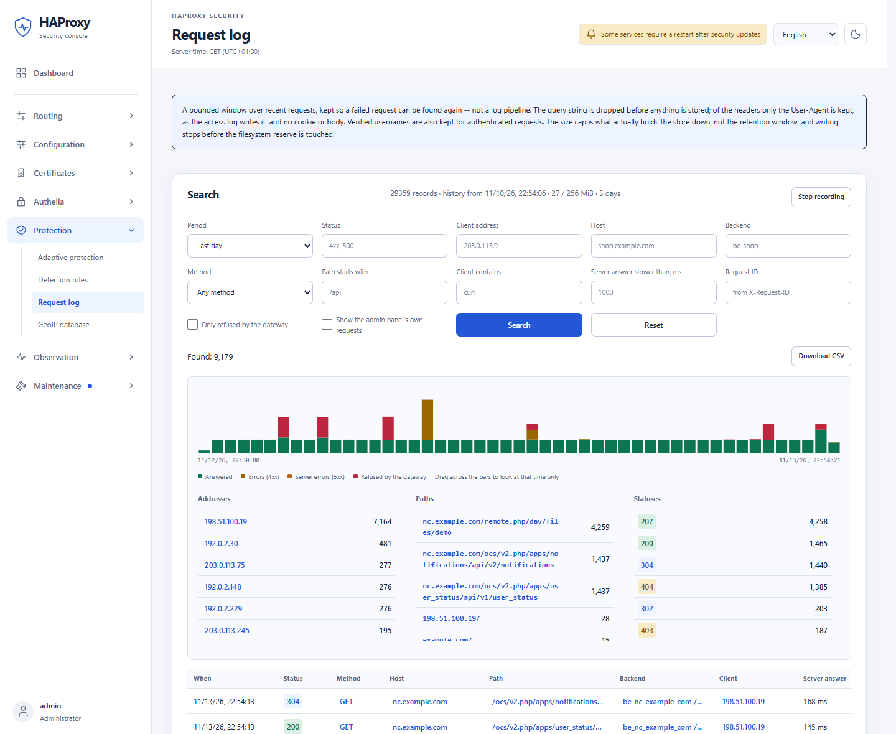<br><b>Request log.</b> Find any failed request by address, host, path, status or speed; export to CSV.</td>
  </tr>
  <tr>
    <td>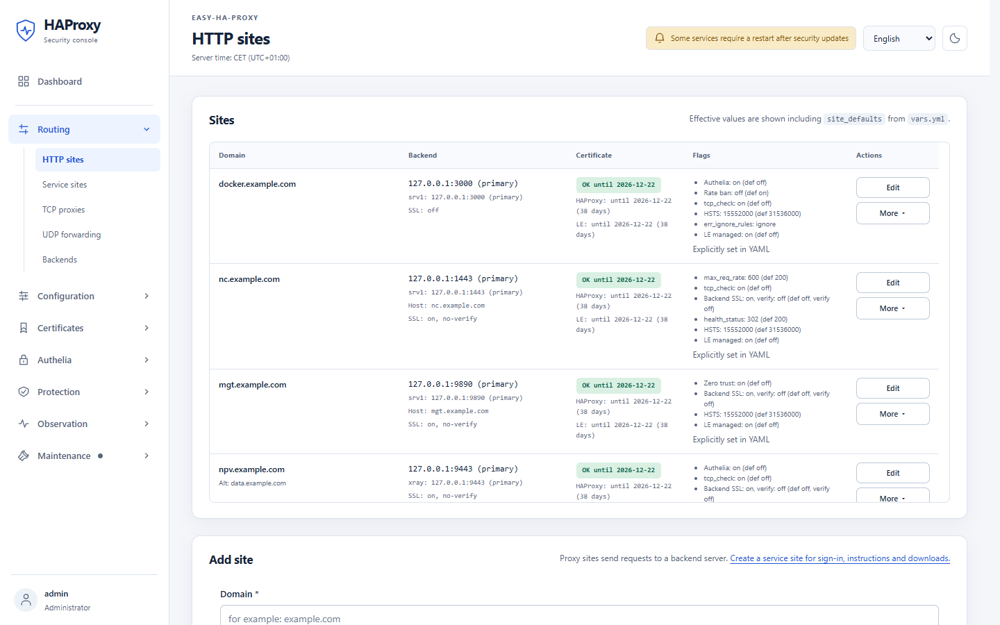<br><b>Sites.</b> Backends, certificates and protection flags of every site at a glance.</td>
    <td>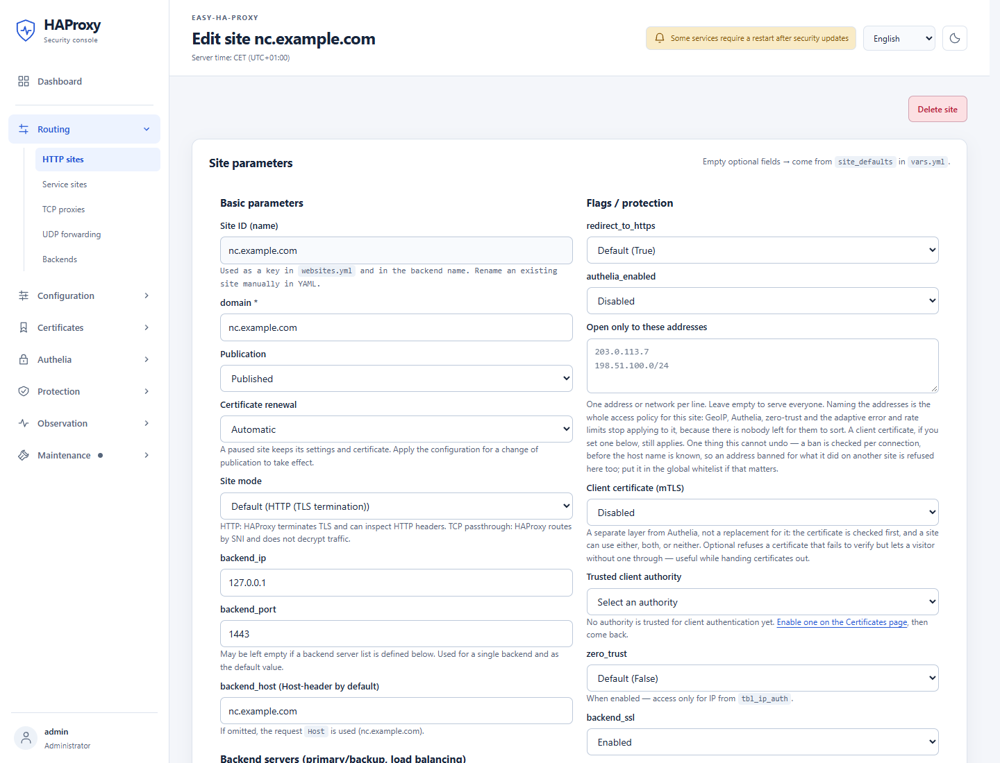<br><b>Site editor.</b> Authelia, allow-lists, mTLS, zero trust and backend TLS per site, no YAML needed.</td>
  </tr>
  <tr>
    <td>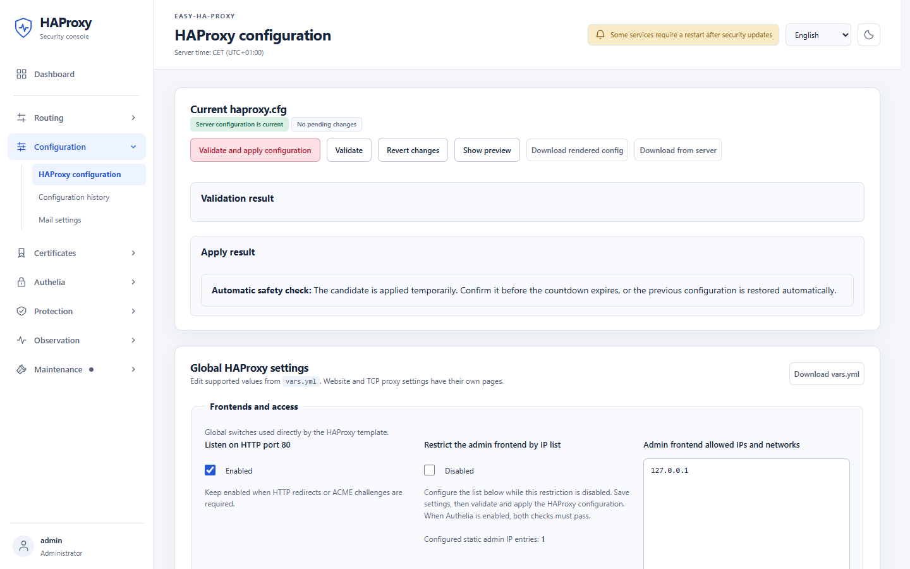<br><b>Safe apply.</b> A new configuration is validated, applied on trial and rolled back automatically unless you confirm it.</td>
    <td>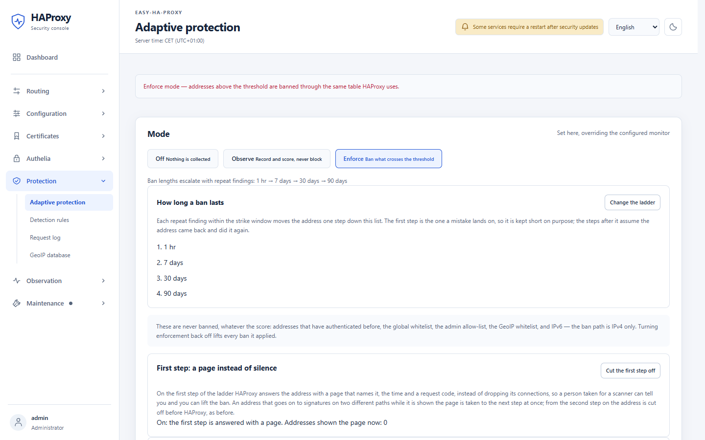<br><b>Adaptive protection.</b> Off, observe or enforce, with an escalating ban ladder.</td>
  </tr>
</table>

<details>
<summary><b>More screenshots</b></summary>

<table>
  <tr>
    <td width="50%">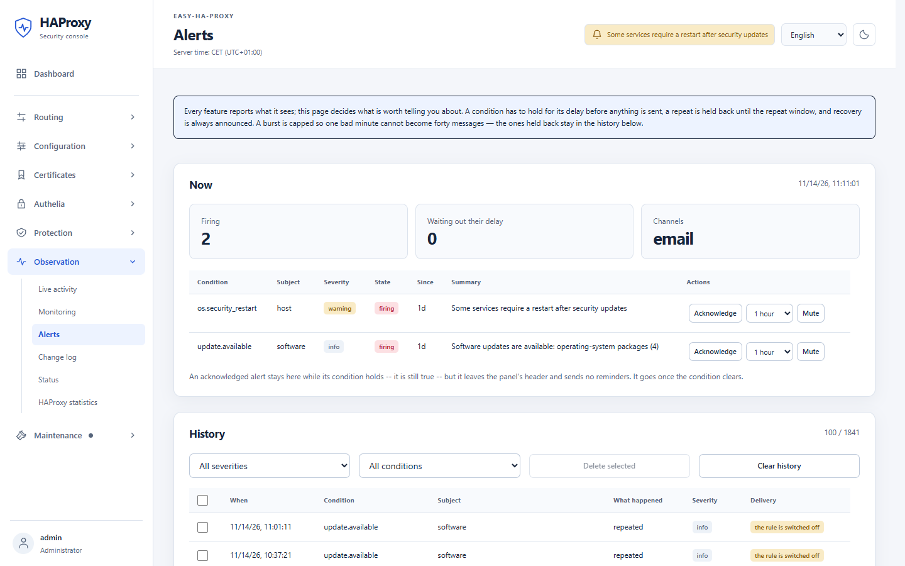<br><b>Alerts.</b> Delays, repeats and bursts are handled, so one bad minute is one email.</td>
    <td width="50%">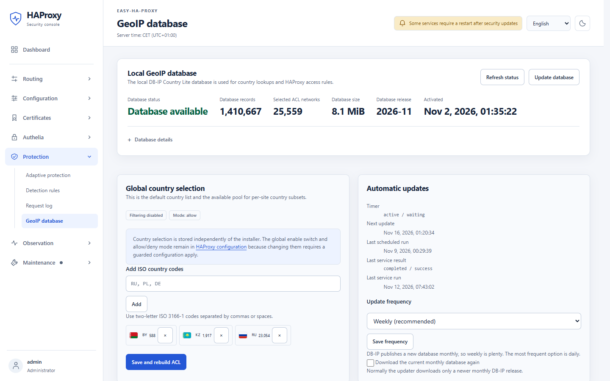<br><b>GeoIP.</b> A local DB-IP database, updated automatically; filter by country per site.</td>
  </tr>
  <tr>
    <td>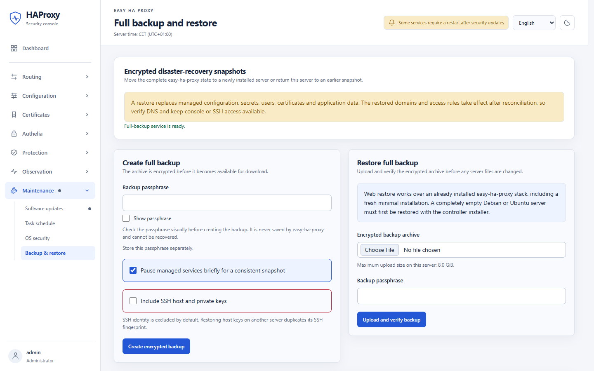<br><b>Backup &amp; restore.</b> Encrypted full snapshots, with off-host copies over SFTP or S3.</td>
    <td>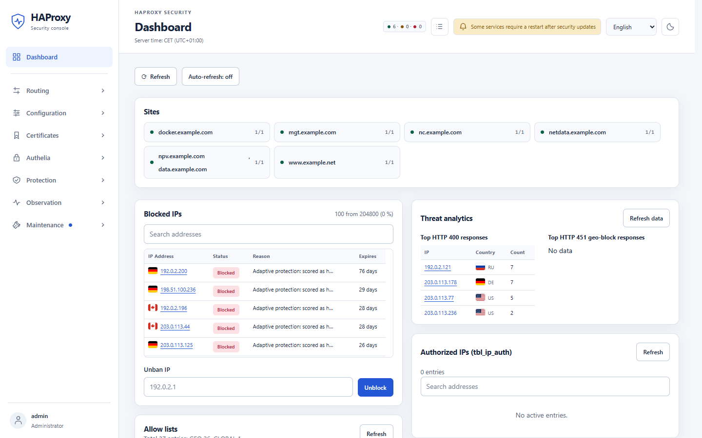<br><b>Light theme.</b> Every page in both themes and both languages.</td>
  </tr>
</table>

</details>

## Features

- **Routing.** HTTP/HTTPS sites, TCP proxies with TLS passthrough, UDP
  forwarding (for example WireGuard) with an automatic backup backend, several
  backends per site with health checks, maintenance pages.
- **Certificates.** Let's Encrypt issuance and renewal (HTTP-01, or DNS-01 for
  wildcards), a built-in certificate authority, import of PEM, DER and PKCS#12,
  standby certificates, delivery of certificates to other machines.
- **Access.** Authelia SSO with users, groups and per-site policies. Zero trust
  for sites, TCP and UDP: a sign-in page authorizes the visitor's address, and
  only authorized addresses get through. Also IP allow-lists, GeoIP and client
  certificates.
- **Protection.** Adaptive scoring of scanners and brute force, editable
  detection rules, a page instead of silence on the first ban step (so a real
  person can tell you), rate limits, bans in HAProxy and in the firewall.
- **Observability.** Dashboard, monitoring history, live activity, request log,
  configuration history and change log, email alerts, Prometheus `/metrics`.
- **Operations.** Updates from the panel, including OS security updates, with an
  optional night-time auto-install (off by default). Encrypted backup and
  restore with off-host copies. A command-line assistant
  (`sudo easy-ha-proxy-assistant`) for status, repair and domain migration.

## How it works

```text
Clients ──► HAProxy on the host (:80/:443, TCP ports)
              ├─ your HTTP/HTTPS and TCP backends
              ├─ login check ──► Authelia (127.0.0.1:9091) ──► Redis
              └─ admin domain ──► web panel (127.0.0.1:5000)
                                     └─ narrow UNIX-socket helpers on the host
Clients (UDP) ──► kernel DNAT ──► your UDP backends
```

Ansible, in its own virtual environment on the server, manages packages,
systemd units, the HAProxy configuration, certificates and the Docker Compose
services. You never have to touch it: the assistant and the panel drive it for
you.

## Documentation

- [Quick Start](docs/quickstart.md): the shortest path to a first installation
- [Full guide](docs/guide.md): every page of the panel and every setting
- [Installer guide](docs/installer.md): updates, migration, backup and recovery from the command line
- In Russian for now: [OS security updates](docs/os-security-updates.md) · [Detection rules](docs/detection-rules.md) · [HAProxy 3.4 migration](docs/haproxy-3.4-migration.md)

## Security

Do not expose the panel port `5000` or the Authelia port `9091` directly; both
are meant to be reached through HAProxy only. If you find a vulnerability,
please report it privately through
[GitHub security advisories](https://github.com/CLLlAgOB/easy-ha-proxy/security/advisories/new)
rather than in a public issue.

## License

[GPL-3.0](LICENSE). Third-party components are listed in
[THIRD_PARTY_NOTICES.md](THIRD_PARTY_NOTICES.md).
