<div align="center">

# easy-ha-proxy

**Защищённый HTTPS-шлюз для ваших сервисов, который ставится одной командой.**

HAProxy, Let's Encrypt, единый вход Authelia и адаптивная защита от атак,
всё управляется из понятной веб-панели. Работает на VPS, домашнем сервере или
ARM-плате.

[](https://github.com/CLLlAgOB/easy-ha-proxy/actions/workflows/ci.yml)
[](LICENSE)


[English](README.md) | [Русский](README.ru.md)

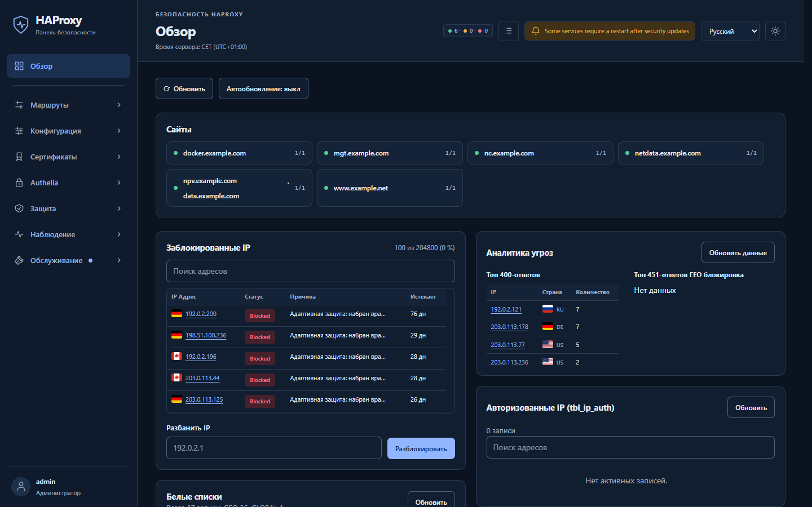

</div>

## Почему easy-ha-proxy

**Установка одной командой.** Интерактивный помощник на русском или английском
настраивает всё прямо на сервере или с вашего ноутбука по SSH. Он сам видит,
что уже установлено, и предлагает только уместные шаги. Публичного DNS пока
нет? Тестовый режим работает с локальным УЦ, а потом переводится в production
без переустановки.

**Безопасно по умолчанию.** Все страницы управления закрыты Authelia с
двухфакторным входом (TOTP, WebAuthn/passkeys). Адаптивная защита оценивает
сканеры и подбор паролей и банит их в HAProxy и в файрволе. Повторным
нарушителям бан удлиняется: 1 час, 7 дней, 30 дней, 90 дней. Дополнительно
для каждого сайта есть GeoIP-фильтр, списки разрешённых адресов, zero trust и
клиентские сертификаты (mTLS). Панель работает без привилегий и обращается к
хосту только через узкие служебные API. GeoIP и флаги стран работают офлайн,
адреса посетителей никуда не уходят.

**Порты открываются только после входа.** Отметьте TCP-прокси, UDP-проброс
или сайт как zero trust, и он будет отвечать только адресам, которые прошли
вход. RDP, SSH, WireGuard, база данных или игровой сервер остаются закрытыми
для интернета. Пользователь открывает вашу страницу входа, проходит Authelia
с двухфакторной проверкой, и его текущий IP-адрес получает доступ на заданное
время. На клиенте ничего ставить не нужно, VPN настраивать тоже. На той же
странице можно разместить инструкции и файлы для пользователей.

**Быстро и легко.** Основную работу на входе делает HAProxy. Весь стек (HAProxy,
Authelia, Redis, панель и её служебные демоны) занимает около **300 МБ
памяти**. Замерено на 4-ядерной ARM64-плате с 2 ГБ. Изменения конфигурации
применяются бесшовной перезагрузкой HAProxy, открытые соединения не рвутся.
Обновление может выполнить только те шаги, которые нужны изменившимся
файлам.

**Всё на виду.** Обзорная панель, графики мониторинга от часа до года,
активность онлайн, журнал запросов с поиском и выгрузкой в CSV, оповещения на
почту и эндпоинт для Prometheus. Интерфейс на русском и английском, в светлой
и тёмной теме.

## Быстрый старт

Нужен сервер с Debian 12+ или Ubuntu 22.04+ (amd64 или arm64), root или
`sudo`, открытые порты 80 и 443 и DNS-записи для домена панели и домена входа.
Если DNS-записей нет, используйте тестовый режим.

```bash
curl -fsSLo /tmp/easy-ha-proxy-install.sh https://raw.githubusercontent.com/CLLlAgOB/easy-ha-proxy/main/install.sh
```

```bash
bash /tmp/easy-ha-proxy-install.sh
```

Скрипт сначала сохраняется в файл, так что его можно прочитать перед запуском.
Помощник спросит домены, адрес почты для Let's Encrypt и первую учётную запись
администратора. Когда он закончит, откройте домен панели, войдите через
Authelia, и вы в панели.

Другие варианты запуска:

```bash
bash /tmp/easy-ha-proxy-install.sh remote admin@server.example.com
```

```bash
bash /tmp/easy-ha-proxy-install.sh local --test-mode
```

Первый ставит на удалённый сервер по SSH с вашей машины, где нужны только
`bash`, `curl`, `ssh` и `scp`. Второй ставит без публичного DNS, на доменах
`.test` с локальным УЦ.

По шагам: [краткое руководство](docs/quickstart.ru.md) · все параметры:
[руководство по установщику](docs/installer.ru.md).

## Скриншоты

<table>
  <tr>
    <td width="50%">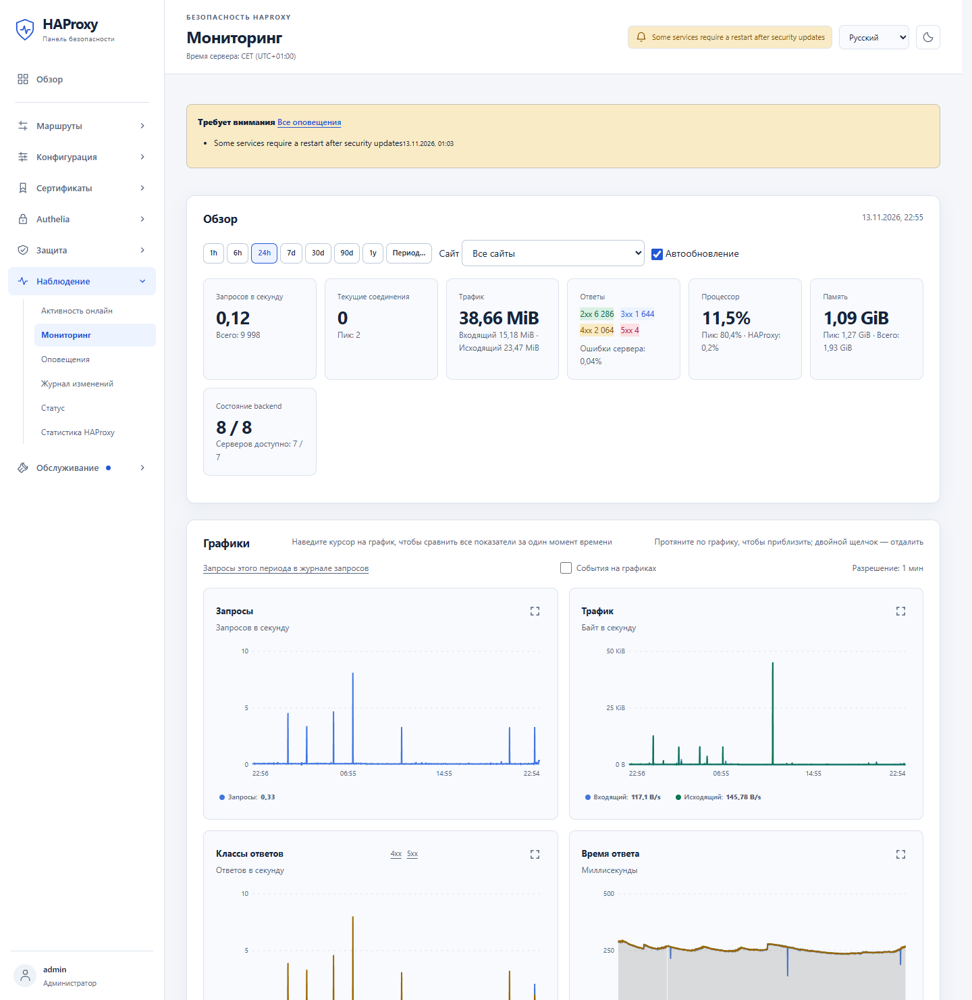<br><b>Мониторинг.</b> Запросы, трафик, классы ответов и время ответа, от часа до года.</td>
    <td width="50%">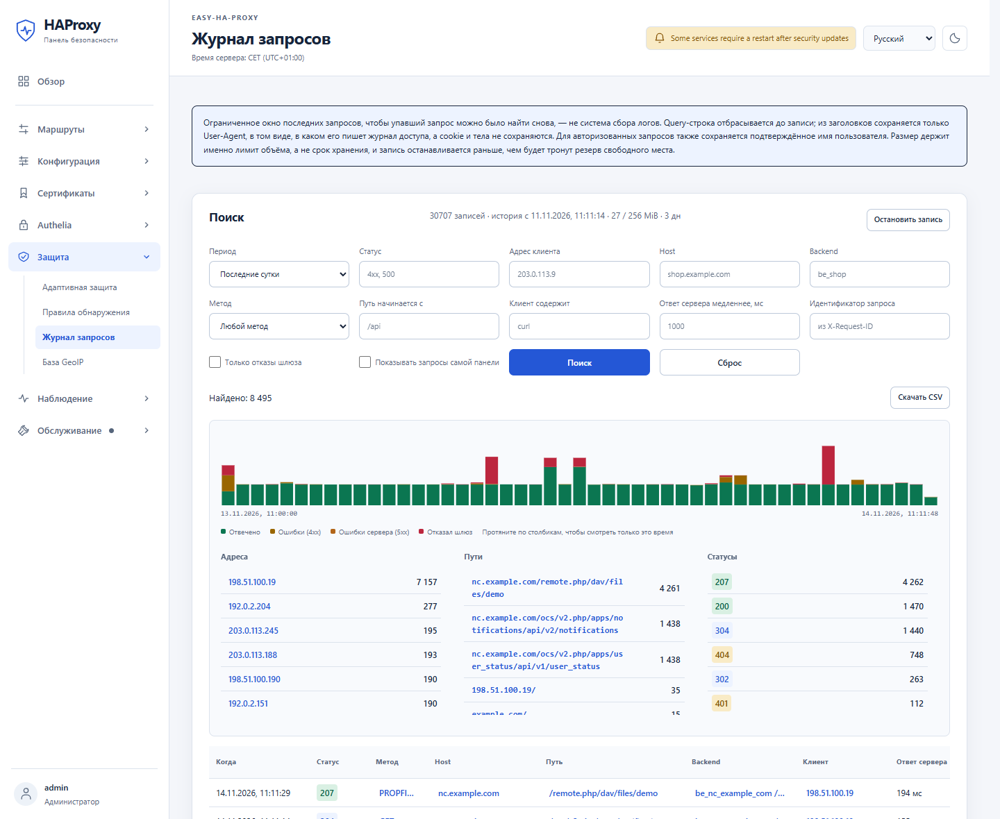<br><b>Журнал запросов.</b> Любой неудачный запрос находится по адресу, хосту, пути, статусу или скорости; выгрузка в CSV.</td>
  </tr>
  <tr>
    <td>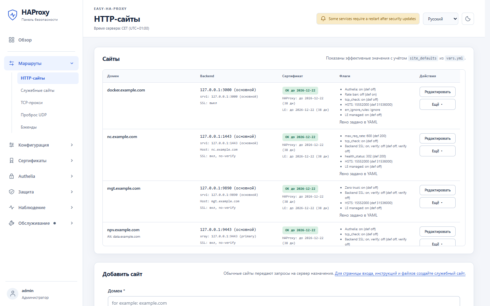<br><b>Сайты.</b> Бэкенды, сертификаты и флаги защиты каждого сайта на одном экране.</td>
    <td>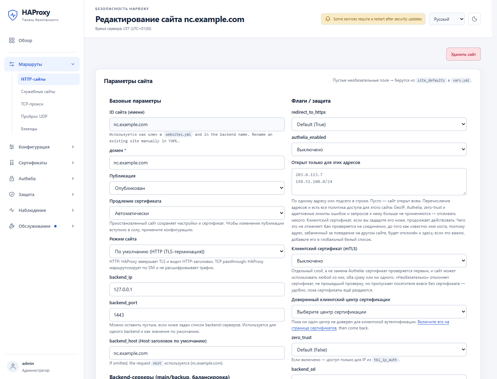<br><b>Редактор сайта.</b> Authelia, списки адресов, mTLS, zero trust и TLS до бэкенда для каждого сайта, без правки YAML.</td>
  </tr>
  <tr>
    <td>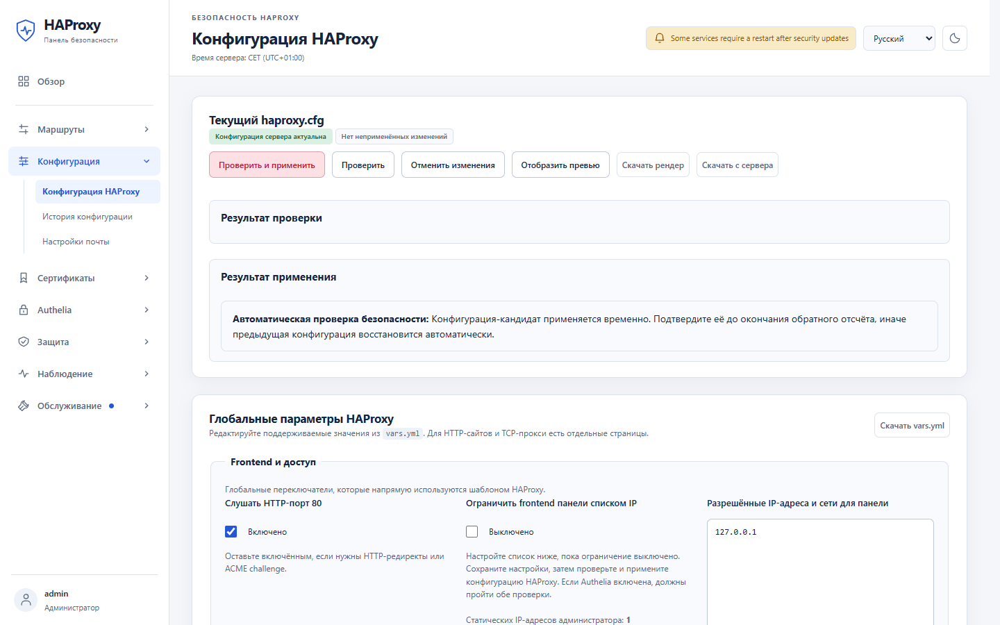<br><b>Безопасное применение.</b> Новая конфигурация проверяется, применяется на пробу и сама откатывается, если вы её не подтвердили.</td>
    <td>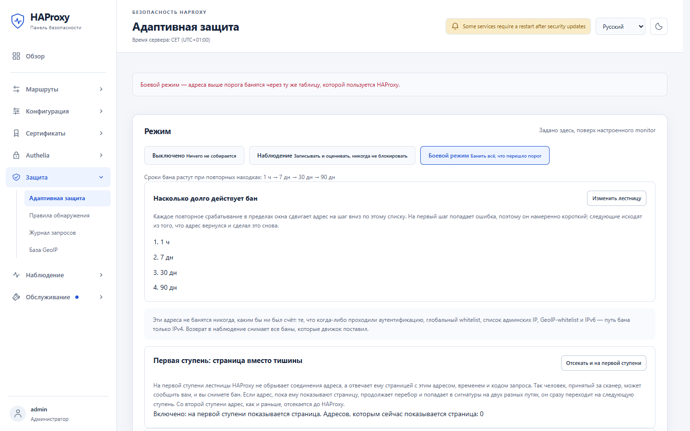<br><b>Адаптивная защита.</b> Выключена, наблюдение или блокировка, с нарастающей лестницей банов.</td>
  </tr>
</table>

<details>
<summary><b>Ещё скриншоты</b></summary>

<table>
  <tr>
    <td width="50%">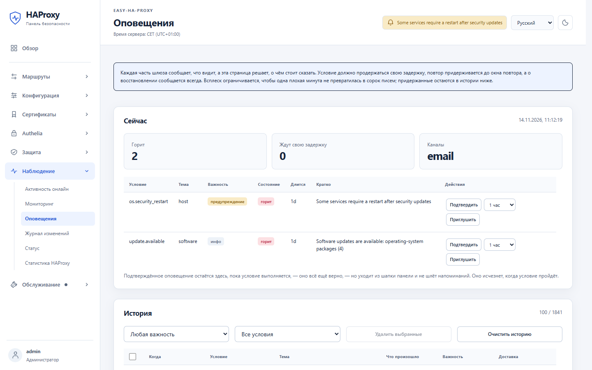<br><b>Оповещения.</b> Задержки, повторы и всплески учтены: одна плохая минута даёт одно письмо.</td>
    <td width="50%">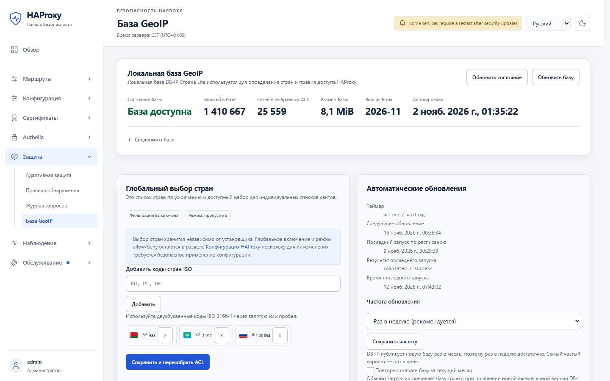<br><b>GeoIP.</b> Локальная база DB-IP с автообновлением; фильтр по странам для каждого сайта.</td>
  </tr>
  <tr>
    <td>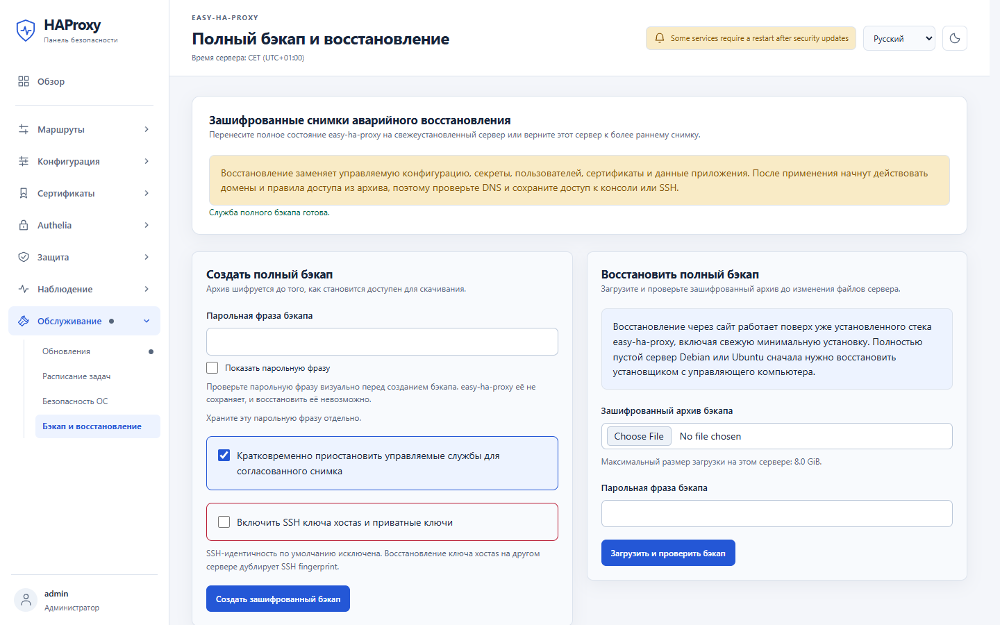<br><b>Резервные копии.</b> Зашифрованные полные снимки и копии вне сервера по SFTP или S3.</td>
    <td>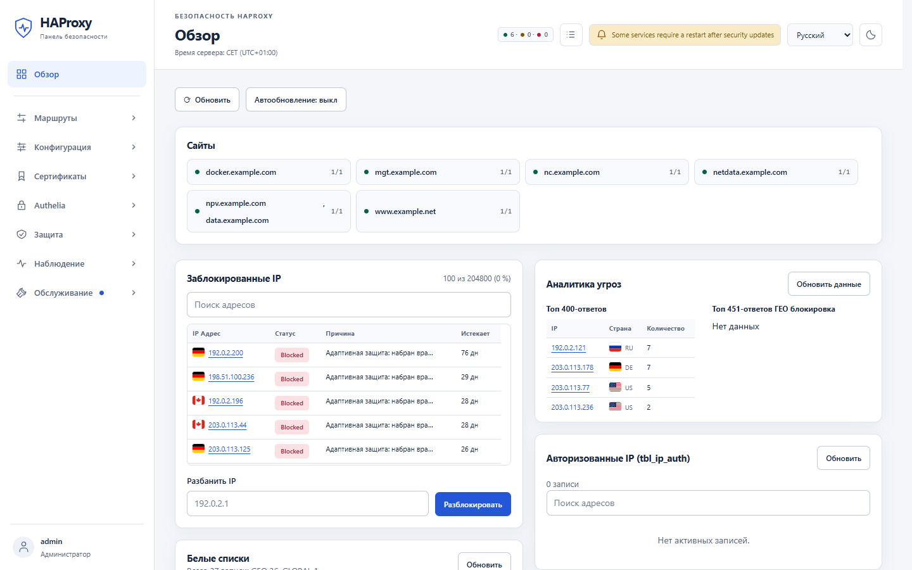<br><b>Светлая тема.</b> Все страницы в обеих темах и на обоих языках.</td>
  </tr>
</table>

</details>

## Возможности

- **Маршрутизация.** HTTP/HTTPS-сайты, TCP-прокси с пропуском TLS по SNI,
  проброс UDP (например, WireGuard) с автоматическим резервным бэкендом,
  несколько бэкендов на сайт с проверками здоровья, страницы обслуживания.
- **Сертификаты.** Выпуск и продление Let's Encrypt (HTTP-01, или DNS-01 для
  wildcard), встроенный удостоверяющий центр, импорт PEM, DER и PKCS#12,
  резервные сертификаты, доставка сертификатов на другие машины.
- **Доступ.** Единый вход Authelia с пользователями, группами и политиками по
  сайтам. Zero trust для сайтов, TCP и UDP: страница входа авторизует адрес
  посетителя, и пропускаются только авторизованные адреса. А также списки
  разрешённых адресов, GeoIP и клиентские сертификаты.
- **Защита.** Адаптивная оценка сканеров и подбора паролей, редактируемые
  правила обнаружения, страница вместо молчания на первой ступени бана (чтобы
  живой человек мог вам сообщить), ограничение частоты, баны в HAProxy и в
  файрволе.
- **Наблюдение.** Обзорная панель, история мониторинга, активность онлайн,
  журнал запросов, история конфигурации и журнал изменений, оповещения на
  почту, Prometheus `/metrics`.
- **Эксплуатация.** Обновления из панели, включая обновления безопасности ОС, с
  необязательной ночной автоустановкой (по умолчанию выключена). Шифрованное
  резервное копирование и восстановление с копиями вне сервера. Помощник
  командной строки (`sudo easy-ha-proxy-assistant`) для статуса, ремонта и
  смены домена.

## Как это устроено

```text
Клиенты ──► HAProxy на хосте (:80/:443, TCP-порты)
              ├─ ваши HTTP/HTTPS и TCP бэкенды
              ├─ проверка входа ──► Authelia (127.0.0.1:9091) ──► Redis
              └─ домен панели ──► веб-панель (127.0.0.1:5000)
                                     └─ узкие служебные UNIX-сокеты на хосте
Клиенты (UDP) ──► DNAT в ядре ──► ваши UDP-бэкенды
```

Ansible в собственном виртуальном окружении на сервере управляет пакетами,
юнитами systemd, конфигурацией HAProxy, сертификатами и сервисами Docker
Compose. Трогать его самому не нужно: им управляют помощник и панель.

## Документация

- [Краткое руководство](docs/quickstart.ru.md): самый короткий путь к первой установке
- [Полное руководство](docs/guide.ru.md): все страницы панели и все настройки
- [Руководство по установщику](docs/installer.ru.md): обновления, миграция, резервные копии и восстановление из командной строки
- [Обновления безопасности ОС](docs/os-security-updates.md) · [Правила обнаружения](docs/detection-rules.md) · [Переход на HAProxy 3.4](docs/haproxy-3.4-migration.md)

## Безопасность

Не открывайте наружу порт панели `5000` и порт Authelia `9091`: к ним
обращаются только через HAProxy. Если вы нашли уязвимость, сообщите о ней
приватно через
[GitHub security advisories](https://github.com/CLLlAgOB/easy-ha-proxy/security/advisories/new),
а не в публичном issue.

## Лицензия

[GPL-3.0](LICENSE). Сторонние компоненты перечислены в
[THIRD_PARTY_NOTICES.md](THIRD_PARTY_NOTICES.md).
